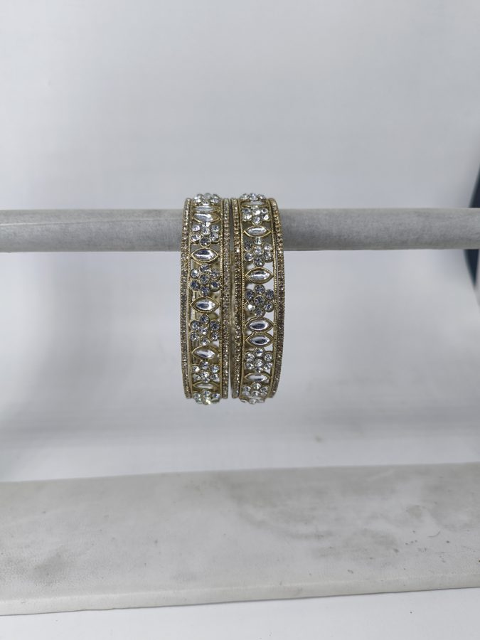
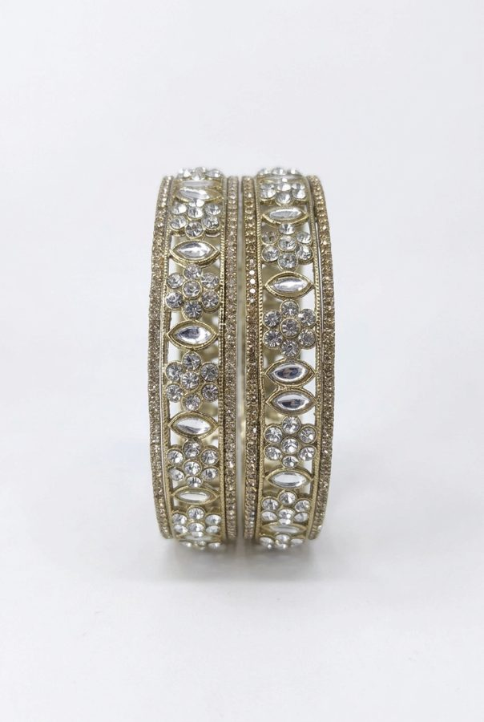
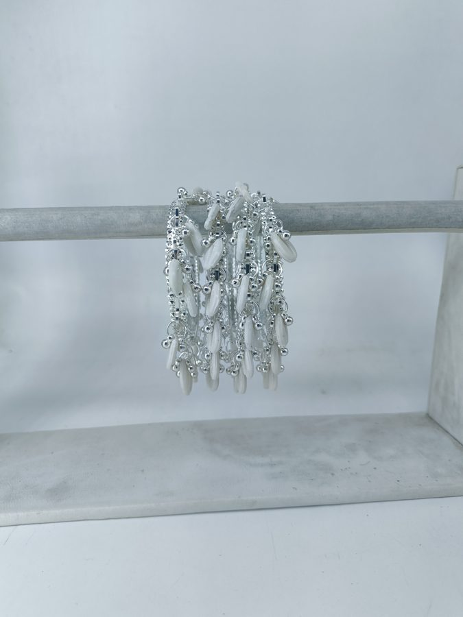
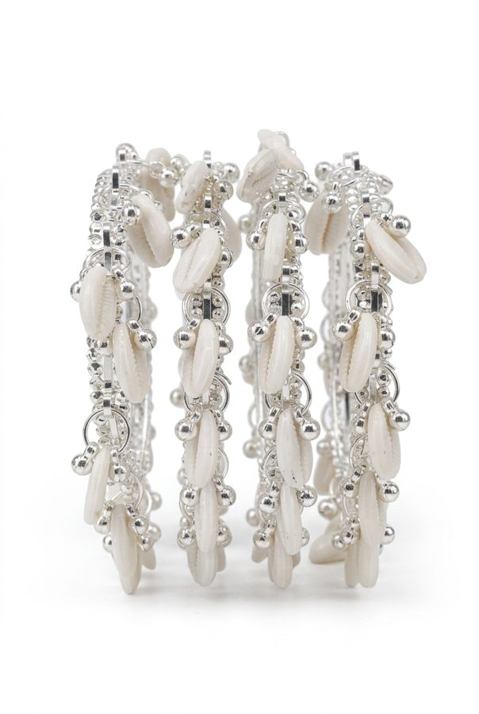

# Bangle Bliss: AI product photos and marketplace listings

How I run the catalogue for **Bangle Bliss**, a small Indian fashion-jewellery brand (glass, kundan, thread and ghungroo bangles). One person, one phone camera, about 120 products across **Shopify, Amazon.in and Flipkart**.

The job is turning a plain phone photo of a bangle set into a full set of marketplace-ready images and listings, with as little manual clicking as possible.

```
phone photo ──► AI image generation ──► checks ──► Shopify / Amazon / Flipkart upload
 (raw/)          Shopify Magic via         bangle count,    bulk sheets, A+ content,
                 Playwright                realism rules    QC polling
```

## Examples

| Raw phone photo | Generated listing image |
|---|---|
|  |  |
|  |  |

Other shot types in the same set: [white studio (Amazon main image)](examples/amazon-white-studio.jpg), [close-up](examples/closeup.jpg), [worn on hand](examples/worn-on-hand.jpg).

## 1. Generating the images (`pipeline/`)

I tried the Gemini API, Antigravity and a Modal-hosted Qwen model first (early tests are not included). What worked best for this product was driving **Shopify Magic** (the image editor inside Shopify admin) with Playwright, using a persistent browser profile so the login survives.

- [`execution_agent.py`](pipeline/execution_agent.py): the worker. It reads a job queue (`image_queue.json`), opens Magic in one or more browser workers, saves results, retries failures up to 3 times, and uploads finished files to Shopify through the Shopify CLI's GraphQL access.
- [`factory.py`](pipeline/factory.py) and [`e2e_pipeline.py`](pipeline/e2e_pipeline.py): orchestration from raw photo to Shopify product.
- [`thread_*.py`](pipeline/): the thread-bangle collection. [`thread_cutout.py`](pipeline/thread_cutout.py) cuts the real bangles out of the raw photo, [`thread_creative.py`](pipeline/thread_creative.py) asks Magic for lifestyle scenes, and [`thread_count.py`](pipeline/thread_count.py) **counts the bangles in the result** (FFT of the column gradient) and rejects images that don't show exactly 12.
- [`design4_*.py`](pipeline/): a random pool of 13 lifestyle prompts per colour, so a catalogue doesn't look copy-pasted.
- [`amazon_main_white.py`](pipeline/amazon_main_white.py): forces the pure-white (255) background Amazon requires on main images.
- Review galleries ([`build_hero_gallery.py`](pipeline/build_hero_gallery.py), [`build_interactive_review_gallery.py`](pipeline/build_interactive_review_gallery.py), [`apply_review_decisions.py`](pipeline/apply_review_decisions.py)): an HTML page where I accept or reject each image, and a script that applies the decisions.

### Quality rules

AI jewellery images fail in predictable ways, so the rules are written down in [`docs/BANGLE-SHOT-GUIDE.md`](docs/BANGLE-SHOT-GUIDE.md): nothing floats, bangles are rigid rings that don't fuse, worn bangles encircle the wrist, anatomy must be right, and the count has to match the real product. Prompts live in [`docs/gemini-magic-prompt.md`](docs/gemini-magic-prompt.md). The mapping of which raw photo belongs to which product and variant is in [`docs/IMAGE_PRODUCT_MAP.md`](docs/IMAGE_PRODUCT_MAP.md).

## 2. Uploading to Amazon.in (`amazon/`)

- [`build_all_amazon_sheets.py`](amazon/build_all_amazon_sheets.py), [`fill_amazon.py`](amazon/fill_amazon.py), [`fill_required_fields.py`](amazon/fill_required_fields.py), [`build_stb_amazon.py`](amazon/build_stb_amazon.py): fill Amazon's flat-file template (one parent SKU plus colour and size children) from Shopify data. New products clone rows from a listing Amazon already accepted, so only SKU, title, colour and keywords change.
- [`aplus/`](amazon/aplus/): A+ content. [`compose.py`](amazon/aplus/compose.py) lays out module images at Amazon's exact pixel sizes, and [`upload_aplus.py`](amazon/aplus/upload_aplus.py) drives A+ Content Manager with Playwright. I sign in myself once; the script never handles the password.
- Plans and findings: [`AMAZON-FINDINGS-AND-PLAN.md`](amazon/AMAZON-FINDINGS-AND-PLAN.md), [`AMAZON-VISIBILITY-FINDINGS.md`](amazon/AMAZON-VISIBILITY-FINDINGS.md), [`STB-LISTING-PLAN.md`](amazon/STB-LISTING-PLAN.md).

## 3. Uploading to Flipkart (`flipkart/`)

Flipkart has no image API, so everything goes through Seller Hub catalogue files, automated end to end. The full pipeline and the rules I learned from QC rejections are in [`FLIPKART-AUTOMATION.md`](flipkart/FLIPKART-AUTOMATION.md) and [`flipkart-qc-learnings.txt`](flipkart/flipkart-qc-learnings.txt).

1. Images are hosted on public Google Drive links ([`fk_drive_v6.py`](flipkart/fk_drive_v6.py)), because Flipkart rejects Shopify CDN URLs.
2. [`fk_quick.py`](flipkart/fk_quick.py) downloads the catalogue file, [`fk_fill_by_sku.py`](flipkart/fk_fill_by_sku.py) fills it by Seller SKU, and `fk_quick.py upload` uploads it.
3. [`fk_qc_poll.py`](flipkart/fk_qc_poll.py) polls until QC finishes and [`fk_qc_errfile.py`](flipkart/fk_qc_errfile.py) groups the failure reasons.

## 4. Shopify (`shopify/`)

Product and variant scripts, plus [`STORE-AUDIT-2026-10-16.md`](shopify/STORE-AUDIT-2026-10-16.md), an India-specific audit of the store (COD, UPI, pincode checks, festive sales). The `shopify-variant-photos` skill covers the file naming that makes a colour variant show only its own photos.

## 5. Skills (`skills/`)

Reusable instruction files for Claude Code that I wrote so the same steps run the same way each time:

| Skill | Does |
|---|---|
| `amazon-scale`, `flipkart-scale` | Build bulk listing sheets from the master template |
| `amazon-seo`, `flipkart-seo`, `shopify-seo`, `seo` | Keyword research and title patterns that rank |
| `amazon-aplus-content` | A+ module plan and upload |
| `amazon-health-audit` | Listing visibility and suppression checks |
| `indian-ecommerce-builder` | Audit and build a Shopify store for the Indian market |
| `shopify-variant-photos` | Photo naming so variants filter correctly |

## Tools

Python, Playwright, Pillow, openpyxl, Shopify CLI (GraphQL Admin API), Chrome DevTools Protocol, Claude Code.

## Notes

- This is a working repository from a real store, not a packaged product. Scripts are shown as I use them. Paths, store domain and SKUs are placeholders (`<project-dir>`, `your-store.myshopify.com`) and need adapting.
- Credentials, browser profiles, order and seller data, and client work are not included.
- Product photos are the brand's own.
